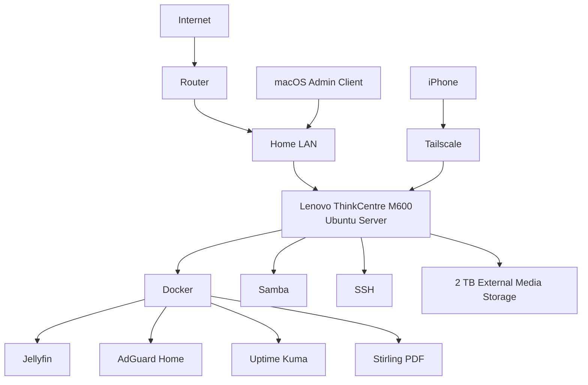

# M600 Homelab

A hands-on Linux homelab built on a repurposed Lenovo ThinkCentre M600 to develop practical experience with Linux administration, Docker, networking, monitoring, storage, remote access, troubleshooting, and self-hosted services.

This project is designed to document not only what was built, but also how the environment is maintained, monitored, troubleshot, and improved over time.

---

## Project Goals

The primary goals of this homelab are to build practical experience relevant to:

- IT Support
- Help Desk
- Junior Systems Administration
- Linux Administration
- Cloud Infrastructure
- Networking
- Docker and containerized services
- Troubleshooting and incident response
- Technical documentation

---

## Hardware

### Server

- Lenovo ThinkCentre M600
- Intel Pentium N3700
- 4 GB DDR3L RAM
- 1 TB internal drive
- 2 TB external WD media drive

### Client Devices

- macOS laptop
- iPhone
- Smart TV / streaming devices

---

## Operating System

- Ubuntu Server 24.04 LTS
- Headless operation
- OpenSSH
- LVM storage
- Docker
- Docker Compose

The server is primarily administered remotely over SSH.

---

## Architecture

## Documentation

- [Architecture and storage](architecture/overview.md)
- [SSH access and health checks](knowledge-base/ssh-access.md)
- [Service ports](knowledge-base/service-ports.md)
- [Jellyfin restart incident](incidents/jellyfin-restart-incident.md)
- [MacBook DNS resolution failure (administration client)](incidents/macbook-dns-resolution-failure.md)
- [Backup and restore workflow](changes/backup-system.md)
- [Work completed and next steps](changes/progress.md)

## Documented Services

Docker hosts Jellyfin, AdGuard Home, Uptime Kuma, and Stirling PDF. Samba, OpenSSH, and Tailscale run as host services. Application data is organized under `/srv/docker`; the external media drive is mounted at `/srv/media` using its filesystem UUID in `/etc/fstab`.

Uptime Kuma monitoring covers Jellyfin, AdGuard Home, SSH, Samba, and Uptime Kuma itself. SSH uses key authentication, with password authentication disabled after key access was verified.

## Project Status

This repository records the setup described in the project notes; it is not a live health report. Configuration backup and isolated restore testing are completed as documented below; broader recovery testing, expanded monitoring, and further service hardening remain goals. Deployment files and screenshots have not yet been added. The Jellyfin incident still needs its root cause and resolution recorded.

Example addresses and usernames are placeholders. Substitute your own values when following the access notes.

## Backup and recovery evidence

Docker application data under `/srv/docker` and selected host configuration were manually backed up to `/srv/media/.server-backups/manual/` on a separate physical disk. Archive contents were checked, SHA-256 verification succeeded, and the archive was extracted into `/srv/restore-test` without overwriting production. Tested restored Compose files matched production using `diff`.

The backup script and systemd service/timer are configured for nightly `02:00` backups with `Persistent=true`, checksums, logging, and removal of daily backup files older than seven days. Supplied terminal evidence at `2026-10-13T00:49:45+00:00` shows a completed scripted backup in the daily directory, all four services running afterward, and the timer enabled and waiting. An unattended overnight run has not been demonstrated.

Media is excluded. Backups are on a different disk but are not yet off-site/off-host disaster-recovery backups. Full host rebuild/bare-metal recovery, application data recovery, and LVM snapshot rollback remain untested; LVM rollback is future work.

See [backup and restore workflow](changes/backup-system.md) and [progress](changes/progress.md) for protected paths, verification scope, limitations, and remaining work.
